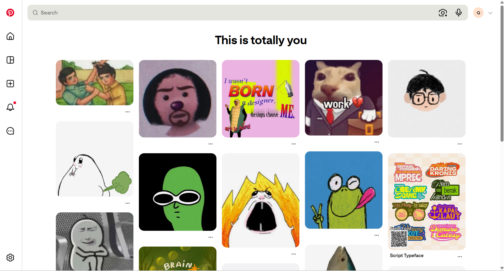

## Hi there 👋

Hi everyone! I'm Qian Hui, a final-year Computer Science student majoring in Software Engineering at Universiti Malaya.

I enjoy developing software applications and learning how to build systems that solve real-world problems. My experience includes web and mobile application development, and I'm currently working on a food-sharing application as part of my Final Year Project.

For this course, I hope to understand how software is maintained and improved after its initial development. I'm particularly interested in learning how to identify and fix bugs, refactor existing code, improve software quality, and adapt systems to changing user requirements. I also hope to gain practical experience in maintaining real-world software projects, since I believe developing software is not just about making it work initially, but also ensuring that it remains useful and reliable over time.

I'm looking forward to learning with everyone this semester!

NICE TO MEET YOU ALL!

